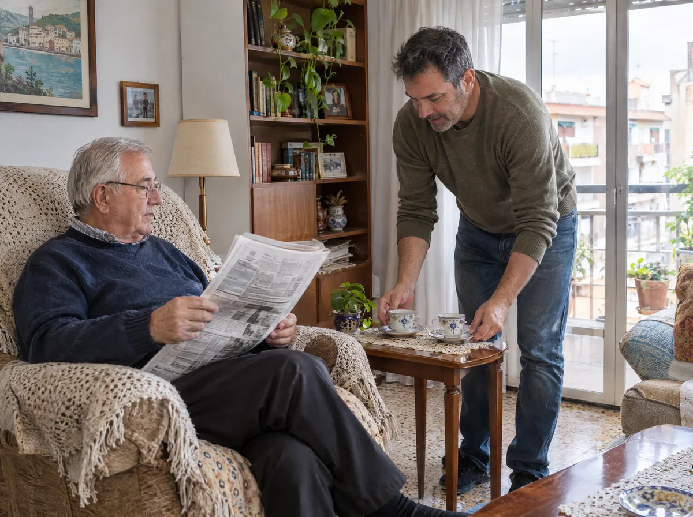

Vender la nuda propiedad es una decisión importante. No se toma en una tarde ni la toma una sola persona. Casi siempre se habla en familia, alrededor de la mesa de la cocina, con un cuaderno y muchas preguntas.

En este artículo ponemos sobre la mesa **las ventajas y las desventajas reales**, sin adornos. Si todavía no tienes claro el concepto, empieza por nuestra guía sobre [qué es la nuda propiedad](/blog/que-es-la-nuda-propiedad/).

## Resumen rápido: pros y contras

| Ventajas | Desventajas |
|---|---|
| Se cobra un capital hoy | El precio es inferior al de vender la casa entera |
| Se sigue viviendo en casa toda la vida | La vivienda sale de la herencia |
| No se genera ninguna deuda | Es una decisión difícil de deshacer |
| Posibles beneficios fiscales para mayores de 65 | Hay que pactar bien gastos y reparaciones |
| El comprador asume las reparaciones grandes | La casa ya no se puede vender entera sin el comprador |

Ahora vamos una por una.

## Cuáles son las ventajas de vender la nuda propiedad

### Liquidez sin mudarse

Es la ventaja principal. La persona mayor **cobra un capital en el momento de la firma** y sigue en su casa, con sus vecinos, su barrio y sus rutinas. Nada cambia en su día a día.

Ese dinero puede servir para muchas cosas: complementar una pensión justa, adaptar la vivienda, pagar ayuda en casa o, sencillamente, vivir con más tranquilidad.

### El usufructo es para toda la vida

Quien vende se reserva el **usufructo vitalicio**. Según el Código Civil, el usufructo se extingue por la muerte del usufructuario (artículo 513). Es decir, nadie puede pedirle que se vaya de su casa mientras viva.

### No es un préstamo

A diferencia de la hipoteca inversa, aquí **no hay deuda ni intereses** que crezcan con los años. Es una compraventa. Lo explicamos con detalle en [nuda propiedad o hipoteca inversa](/blog/nuda-propiedad-o-hipoteca-inversa/).

### Ventajas fiscales para mayores de 65

La Agencia Tributaria recoge en su manual práctico de la renta que está exenta de IRPF la ganancia por transmitir la vivienda habitual a partir de los 65 años. Y aclara que la exención **también se aplica cuando se vende la nuda propiedad y se reserva el usufructo vitalicio**.

Para ello, la vivienda tiene que haber sido su residencia habitual durante al menos tres años seguidos y haber tenido en ese tiempo el pleno dominio. Cada caso tiene matices, así que recomendamos revisarlo siempre con un asesor fiscal antes de firmar.

### Menos preocupación por las obras grandes

Las **reparaciones extraordinarias** corresponden al nudo propietario, es decir, al comprador (artículo 501 del Código Civil). La persona mayor sigue encargándose de las pequeñas reparaciones del uso normal. Si quieres el detalle completo, lo tienes en [quién paga el IBI, la comunidad y las derramas](/blog/nuda-propiedad-quien-paga-que/).

## Cuáles son las desventajas

### El precio es menor que el de la vivienda completa

Se vende la propiedad sin el uso. Por eso el precio es inferior al que se obtendría vendiendo la casa libre. **Cuanto mayor es la persona que vende, más se acerca el precio al valor de la vivienda completa**, porque el comprador espera menos tiempo para usarla.

No es una pérdida escondida. Es la forma de calcular el valor de algo que el comprador no podrá usar durante años. Puedes hacerte una idea orientativa con nuestra [calculadora](/#calculadora).

### La casa deja de formar parte de la herencia

Cuando fallece el usufructuario, el comprador pasa a tener la vivienda entera. Los hijos **no heredan la casa**. Heredan, en su caso, lo que quede del dinero recibido.

Para muchas familias esto no es un problema, porque nadie piensa vivir en esa casa. Para otras sí lo es. Por eso hay que hablarlo antes.

### Es difícil dar marcha atrás

Una vez firmada la escritura, la venta es firme. Si dentro de unos años la familia quiere vender la casa entera, necesitará ponerse de acuerdo con el comprador. Conviene decidir sin prisas y con toda la información.

### Hay que dejar bien atados los gastos

La ley ordena bastante bien quién paga qué. Aun así, algunos puntos como las derramas de comunidad o el seguro **conviene pactarlos por escrito**. Si no se hace, pueden surgir dudas.

## ¿Y si un día tiene que irse a una residencia?

Es una pregunta muy frecuente entre los hijos. El usufructo sigue siendo suyo aunque se traslade. El Código Civil permite al usufructuario **arrendar la vivienda a otra persona** (artículo 480). Ese alquiler termina cuando se extingue el usufructo.

Si la casa deja de ser su vivienda habitual, pueden cambiar algunos aspectos fiscales. Otra vez, lo sensato es consultarlo con un asesor fiscal.

## ¿Para quién tiene sentido y para quién no?

Suele encajar bien cuando:

- La persona mayor tiene la casa pagada y una pensión que se queda corta.
- Quiere seguir viviendo en su casa y no quiere deudas.
- Los hijos tienen su vida hecha y no piensan quedarse con la vivienda.
- No hay herederos y la persona prefiere disfrutar de su patrimonio en vida.

Quizá no sea la mejor opción cuando:

- La familia quiere conservar la casa a toda costa.
- La necesidad de dinero es pequeña o puntual y hay otras salidas.
- La persona tiene previsto mudarse pronto y de forma definitiva.

## Cómo lo hacemos en Nudade

En Nudade trabajamos para **proteger a quien vende**. Explicamos cada punto a la familia, sin prisas ni presiones, y dejamos por escrito quién paga cada gasto. No trabajamos con grandes fondos. Buscamos compradores particulares con un horizonte largo y respeto por quien vive en la casa.

Si estáis valorando esta opción, podéis escribirnos y lo vemos juntos.

## Preguntas frecuentes

### ¿Cuál es la principal ventaja de vender la nuda propiedad?
Cobrar un capital hoy sin dejar la casa. La persona mayor conserva el usufructo de por vida y no asume ninguna deuda.

### ¿Cuál es la principal desventaja?
Que la vivienda deja de formar parte de la herencia y que el precio es inferior al de vender la casa libre. Por eso conviene hablarlo en familia antes de decidir.

### ¿Se paga IRPF al vender la nuda propiedad siendo mayor de 65 años?
Según la Agencia Tributaria, la ganancia está exenta si se vende la nuda propiedad de la vivienda habitual reservándose el usufructo vitalicio y se cumplen los requisitos de residencia y pleno dominio. Revísalo con un asesor fiscal.

### ¿Pueden echar de casa a quien vende la nuda propiedad?
No. El usufructo vitalicio le da derecho a vivir en la casa mientras viva. Solo se extingue por las causas que marca la ley, como el fallecimiento.

### ¿Qué pasa si después necesita ir a una residencia?
Conserva el usufructo. Puede seguir siendo titular de ese derecho e incluso alquilar la vivienda hasta que el usufructo se extinga.
